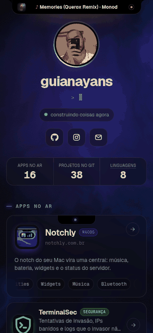
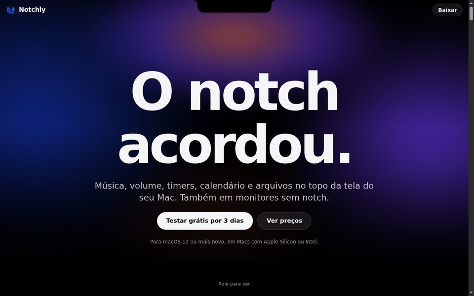
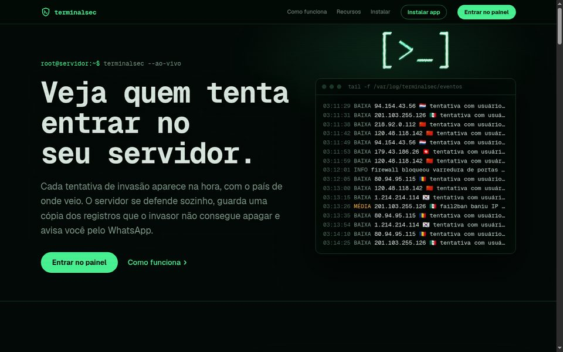
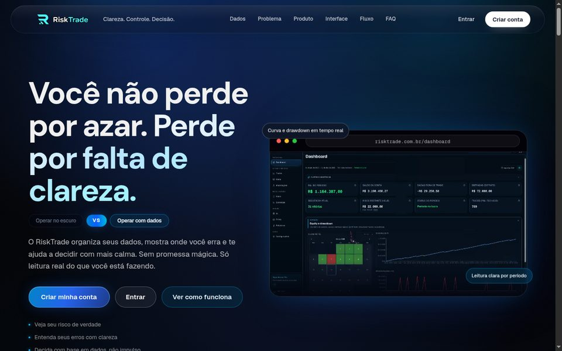
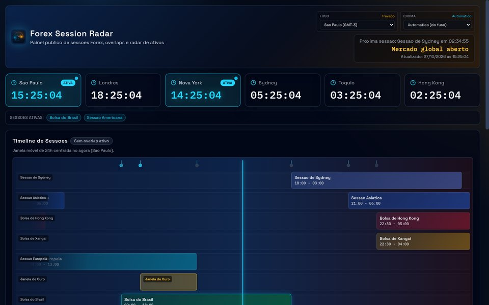
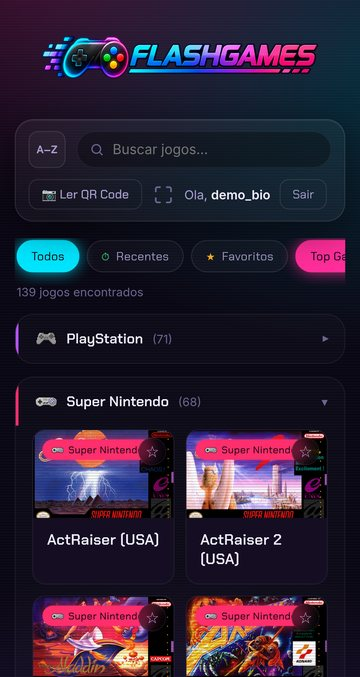
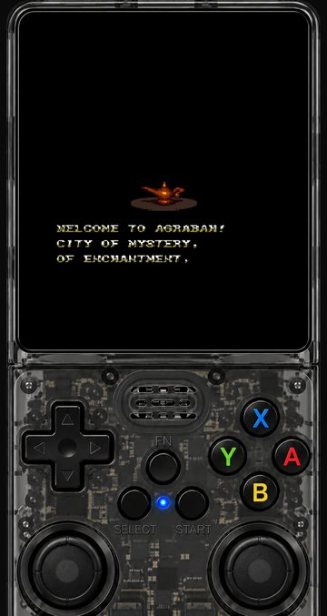
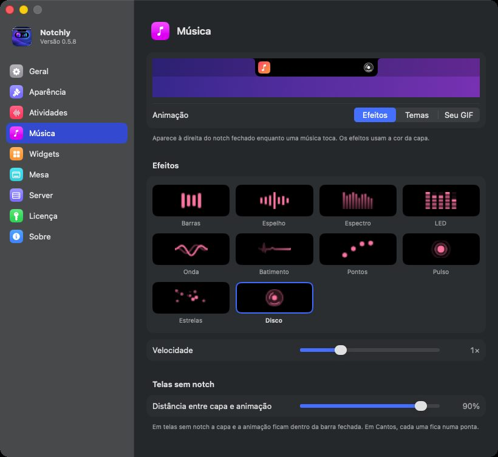
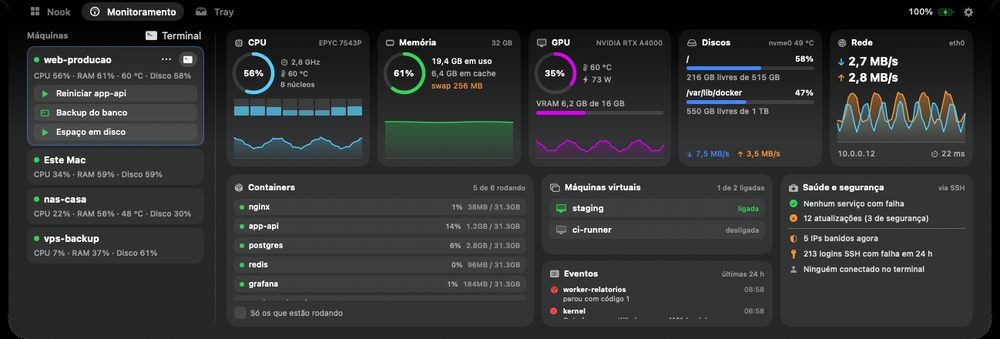
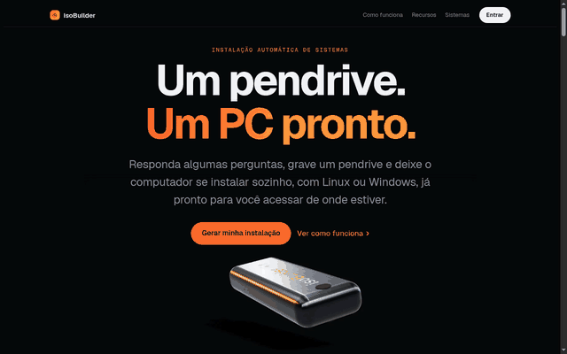

  

  

  
  
  

<table>
<tr>
<td width="62%" valign="top">

### Oi! 👋

Eu construo produtos inteiros, do app ao servidor onde eles rodam.

- 🍎 **No Mac:** o [Notchly](https://notchly.com.br) transforma o notch numa central de música, widgets e monitoramento
- 🛡️ **Na segurança:** o [TerminalSec](https://sec.gvtserver.online) mostra ao vivo quem tenta invadir o servidor, e de onde
- 📈 **No trading:** o [RiskTrade](https://risktrade.com.br) mostra onde o trader erra, com dados em vez de achismo
- 🇧🇷 **Em dados públicos:** o [Brasil Proposta](https://brasilproposta.com.br) reúne todos os candidatos, só com dados oficiais do TSE
- 🏠 **Tudo self-hosted:** **16 apps** rodando no meu próprio servidor, com Docker, Coolify e Cloudflare

São 38 projetos no git, a maioria privada. [Na bio](https://website.gvtserver.online/bio) eles aparecem com codinomes, e o notch toca a minha playlist 🎧

</td>
<td width="38%" align="center" valign="top">
  
   a <a href="https://website.gvtserver.online/bio">bio</a>, com o notch tocando música
</td>
</tr>
</table>

## 🚀 No ar agora

<table>
<tr>
<td width="50%" valign="top">
  
  <h3><a href="https://notchly.com.br">Notchly</a> <code>macOS</code></h3>
  O notch do Mac acordou: música com efeitos, volume, timers, calendário, arquivos e o status do servidor, no topo da tela.
</td>
<td width="50%" valign="top">
  
  <h3><a href="https://sec.gvtserver.online">TerminalSec</a> <code>segurança</code></h3>
  Cada tentativa de invasão aparece na hora, com o país de origem. O servidor se defende sozinho e avisa pelo WhatsApp.
</td>
</tr>
<tr>
<td width="50%" valign="top">
  
  <h3><a href="https://risktrade.com.br">RiskTrade</a> <code>trading</code></h3>
  Performance em day trade, gestão de risco e diário operacional com IA. Você não perde por azar, perde por falta de clareza.
</td>
<td width="50%" valign="top">
  
  <h3><a href="https://brasilproposta.com.br">Brasil Proposta</a> <code>dados públicos</code></h3>
  Todos os candidatos, do vereador ao presidente: partido, patrimônio declarado, votos e resultado, direto do TSE.
</td>
</tr>
<tr>
<td width="50%" valign="top">
  
  <h3><a href="https://forexradar.gvtserver.online">Forex Session Radar</a> <code>open source</code></h3>
  Quem está aberto no mundo, quando Londres e Nova York se encontram e o que merece atenção agora.
</td>
<td width="50%" valign="top" align="center">
  
  
  <h3><a href="https://flashgames.gvtserver.online">FlashGames</a> <code>open source</code></h3>
  Jogos em Flash e consoles clássicos no navegador, com controle na tela do celular e save na nuvem.
</td>
</tr>
</table>

### 🍎 Por dentro do Notchly

<table>
<tr>
<td width="45%"></td>
<td width="55%">  
Dez efeitos que reagem à música e mudam de cor com a capa do álbum. Também mostra CPU, memória, containers e alertas dos servidores sem sair do notch.</td>
</tr>
</table>

## 🧩 Código aberto

| Projeto | O que faz |
|---|---|
| 💿 [**ubuntuIsoBuilder**](https://github.com/guianayans/ubuntuIsoBuilder) | Monta pendrives do Ubuntu Server que se instalam sozinhos, configurados por um painel web |
| 📄 [**pdfToolbox**](https://github.com/guianayans/pdfToolbox) | Extensão de navegador: acha os PDFs da página e extrai, divide, junta e converte |
| 🌊 [**tidalWaves**](https://github.com/guianayans/tidalWaves) | Música feita com código, ao vivo no navegador, com projetos e gravações salvos |
| 🧊 [**Sharp3DViewer**](https://github.com/guianayans/Sharp3DViewer) | Uma foto vira cena 3D navegável com Gaussian Splatting (Apple ml-sharp) |
| 📊 [**gvtmonitor**](https://github.com/guianayans/gvtmonitor) | Painel de vidro para servidores Linux pelo SSH: métricas e containers |
| 🌱 [**GreenHouse**](https://github.com/guianayans/GreenHouse) | Estufa com Arduino: sensores por vaso, bombas e rega automática em tempo real |
| 🗂️ [**GVTNasDiskUtility**](https://github.com/guianayans/GVTNasDiskUtility) | NAS com compartilhamento de arquivos, na rede local ou pela VPN |
| ⬇️ [**DownloaderAnalyser**](https://github.com/guianayans/DownloaderAnalyser) | Explorador de arquivos do servidor com downloads por wget, aria2, git e Hugging Face |
| 🌐 [**selfhost-website**](https://github.com/guianayans/selfhost-website) | Painel para publicar vários sites estáticos, com deploy por rsync e Docker |

  
   o <a href="https://iso.gvtserver.online">ubuntuIsoBuilder</a> no ar, com a animação que acompanha a rolagem

## 🛠️ Ferramentas

  

## 📊 No GitHub

  
  

  

  

